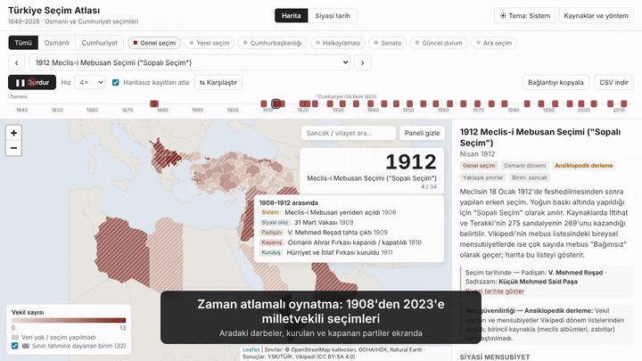
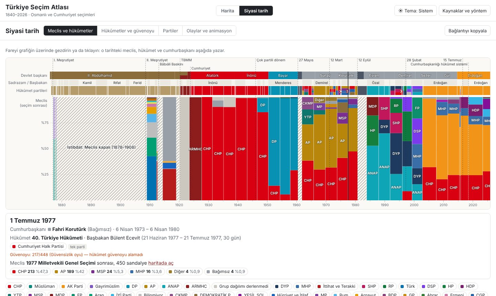
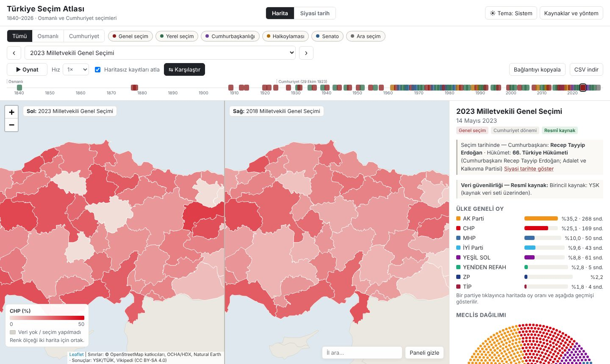
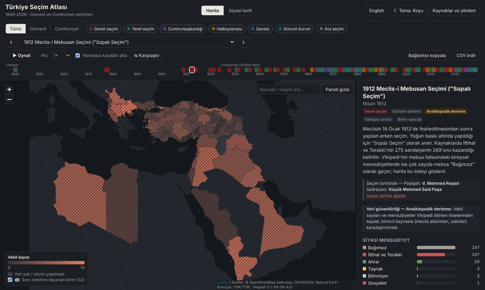
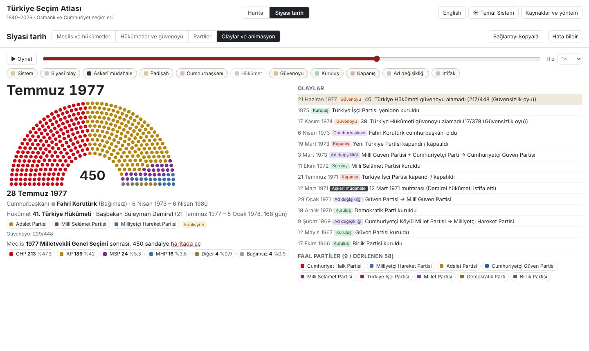
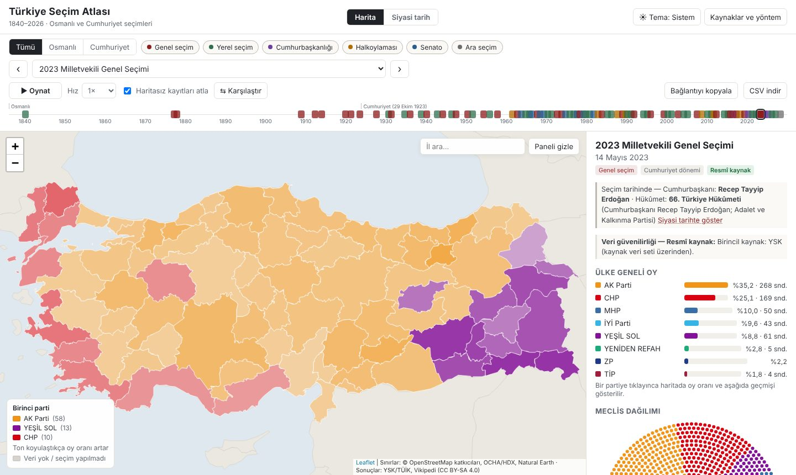
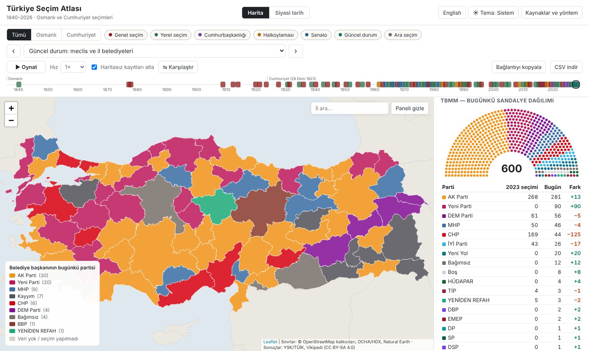
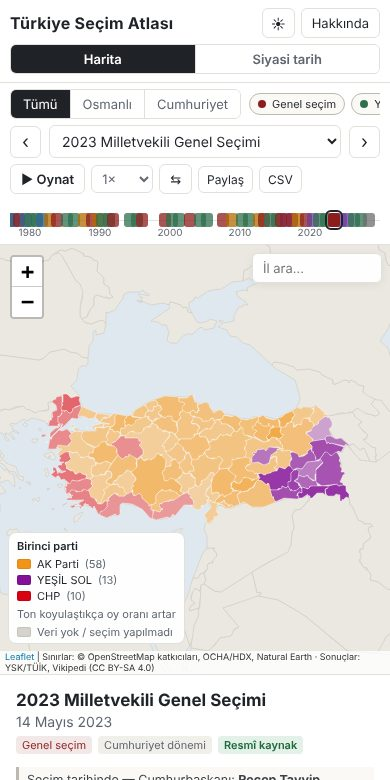

<div align="center">

*[Türkçe README](README.md) · [Open the site in English](https://ahmtaltug.github.io/TurkiyeSecimAtlasi/?lang=en)*

# Turkey Election Atlas

**Ottoman and Turkish Republic elections from 1840 to today, mapped with the boundaries of their time.**<br>
Together with parliaments, governments, sultans, presidents, parties and political events.

[**Open the site →**](https://ahmtaltug.github.io/TurkiyeSecimAtlasi/?lang=en)

[](https://github.com/ahmtaltug/TurkiyeSecimAtlasi/actions/workflows/pages.yml)




▶ [Intro video (90 s, 1080p)](docs/video/tanitim-16x9.mp4)

</div>

## What's inside

| | |
|---|---|
| **88 election records + current state** | The 1840 *muhassıllık* councils, the 1877–1919 Ottoman Chamber of Deputies (*Meclis-i Mebusan*), the 1920–1946 Grand National Assembly (TBMM) elections, 1950–2023 general and local elections, Senate elections, referendums, presidential elections and the 2026 by-election. |
| **Period boundaries** | Ottoman vilayets and sanjaks; for the Republic, the provinces and province names of that year (e.g. Seyhan, Çoruh, Urfa, İçel). Boundaries based on estimates are hatched on the map. |
| **Political history** | Parliamentary seat distribution since 1876, sultans, grand viziers, presidents, prime ministers, 73 governments and their coalitions, votes of confidence, the lineage of 58 parties and 4 alliances, 230 events. |
| **Current state** | Today's seat distribution in the TBMM and the current party of all 81 provincial mayors; updated automatically from Wikipedia every day. |
| **District level** | District results for the 1950/1955 local elections and for every election since 1961, with district boundaries as of the election date. Districts created later are drawn as part of the district they belonged to, under its name at the time. |
| **Analysis** | Side-by-side comparison of two elections, province-by-province change against the previous election of the same type, province and party histories, correlation with demographic indicators. |
| **Source transparency** | Every record has a reliability badge and source links; what was checked and how is described in the [verification report](docs/DOGRULAMA.md) (Turkish). |

<table>
<tr>
<td width="50%"><br><sub><b>Political history:</b> Parliament, governments and heads of state in one chart.</sub></td>
<td width="50%"><br><sub><b>Comparison:</b> Two elections on synchronised maps; province differences in the panel.</sub></td>
</tr>
<tr>
<td><br><sub><b>Ottoman period:</b> The 1912 election, deputies per sanjak (dark theme).</sub></td>
<td><br><sub><b>Events and animation:</b> Parliament, government and events at the selected date.</sub></td>
</tr>
<tr>
<td><br><sub><b>District level:</b> The 2024 local elections in 973 districts; older elections use the district boundaries of their time.</sub></td>
<td><br><sub><b>Current state:</b> Today's parliament and the 81 provincial mayors, updated daily.</sub></td>
</tr>
</table>

Screenshots show the Turkish interface; the site also has a full English interface (`?lang=en`).

## Features

**Map**
- Views: leading party or candidate, a party's vote share, turnout, number of deputies, group share, and change against the previous election.
- Time-lapse playback (0.5×–4×); political events between two elections are shown over the map.
- Election panel: a short description (electoral system, subject of a referendum, notable outcomes; in Turkish), the president and government on election day and, for general elections, every government of that parliament.
- Province card: votes, seats, deputy names before 1950, the province's population indicators and its history across all elections of the same type.
- Party card: national vote history plus founding, closure, renames, predecessor and successor parties, alliances.
- Comparison mode, demographic scatter plot, sortable province table, province search, CSV download.
- Province or district level ("Unit" switch) wherever district data exists.

**Political history**
- *Parliament and governments:* one chart from 1876 to today. Periods without a sitting parliament (the Hamidian era, the 1960 and 1980 military regimes) are hatched.
- *Governments and votes of confidence:* table of Republican governments and Ottoman grand viziers.
- *Parties:* timeline with active periods and renames; clicking a party opens its lineage.
- *Events and animation:* playable timeline from 1876 to today.

**Contributing**
- Each record's panel has a "Is there an error in this record? Report it" link that opens a GitHub issue form pre-filled with a link to the record.
- Wrong information in the current state can be corrected, with a source, in `data/guncel-duzeltmeler.json`.

**Usability**
- Every view opens from a shareable link (e.g. `#e=1946&u=istanbul`, `#v=tarih&t=chart&d=1960-05-27`).
- **Embed:** the current map becomes ready-made code for a news or blog page in one click (`?embed=1`).
- **Text pages:** each election's results by province and its sources on a separate page that needs no JavaScript (e.g. `secim/1977/`), for search engines and screen readers.
- Turkish and English interface; light and dark theme (following the browser setting), mobile layout, keyboard shortcuts (← → space / Esc).
- Works offline and can be installed on a phone as an app (PWA).

<p align="center"></p>

## Coverage

| Period | Elections | Shown on the map |
|---|---|---|
| 1840 | *Muhassıllık* councils | Description only (no compiled results) |
| 1877–1919 | Ottoman Chamber of Deputies: 1877 (I and II), 1908, 1912, 1914, 1919 | Deputies per vilayet or sanjak; affiliation where the source gives it |
| 1920–1946 | TBMM elections, terms I–VIII | Deputies and party per province; approximate provincial votes for 1946 |
| 1930–1946 | Municipal elections | Municipalities won by the Free Republican Party (SCF) in 1930; period boundaries in other years |
| 1950–2024 | 20 general, 15 local, 8 Senate elections, 7 referendums, 4 presidential elections | Provincial votes, shares, seats, turnout |
| 2026 | By-election of 7 June 2026 | Provincial totals of the units that voted |

## Data and reliability

| Data | Source |
|---|---|
| 1950–2026 results, 1950–1999 province boundaries | [Türkiye Seçim Haritası open dataset](https://github.com/hamiKumbasae/turkiye-secim-haritasi) (CC BY-SA 4.0; based on the Supreme Election Council (YSK), TurkStat/DİE and Wikipedia) |
| 1877–1946 deputy lists, governments, grand viziers, presidents, party lineage | Turkish Wikipedia (CC BY-SA 4.0) |
| Provincial population, area, GDP per capita, life expectancy | Turkish and English Wikipedia tables (based on TurkStat data) |
| Base map, regions behind the Ottoman vilayets | [Natural Earth](https://www.naturalearthdata.com/) (public domain) |

Every election record carries a **reliability badge**: official source, encyclopaedic compilation, partial/approximate, or no result data.
Main limitations:

- Boundaries before 1950 are approximate. There are no provincial vote counts before 1950; deputy counts and affiliations are shown instead.
- 1908–1914 affiliations follow the classification of the Wikipedia lists and may not match the aggregate figures in the literature.
- Political history data has not been checked against primary sources (TBMM minutes, the Official Gazette). The parliament chart mostly shows the post-election state.
- Demographic indicators use today's provincial boundaries. There is no provincial urbanisation or migration data; correlation does not imply causation.

Details: [docs/DOGRULAMA.md](docs/DOGRULAMA.md) · Release history: [CHANGELOG.md](CHANGELOG.md) · Possible future work: [ROADMAP.md](ROADMAP.md) (all in Turkish)

## Intro video

`docs/video/tanitim-16x9.mp4` (1920×1080, 30 fps, 90 s): edited frame by frame from real screenshots of the site; music and sound effects were synthesised for this project. The video, GIF, README images and social preview can be rebuilt with the scripts in `scripts/video/` (see the Turkish README for the commands).

## Citation

If you use this project, you can cite it with the information in [CITATION.cff](CITATION.cff); GitHub's **Cite this repository** button gives the same information.
When using the data, please also cite its original sources.

## Publishing your own copy (GitHub Pages)

1. On GitHub, choose **Settings → Pages → Build and deployment → Source: GitHub Actions**.
2. On every push to `main`, `.github/workflows/pages.yml` checks the data and publishes the site.
   Address: `https://<user-name>.github.io/<repo-name>/`

Alternatively, upload `index.html` and the `css/`, `js/`, `vendor/` and `data/` folders from the repository root to Netlify Drop or
Cloudflare Pages. No build step is needed.

To try it locally:

```bash
python3 -m http.server 8000   # http://localhost:8000
```

## Rebuilding the data

The published data (`data/`) is included in the repository. Rebuilding it from scratch needs Python 3, `pip install shapely` and `npm i -g mapshaper`:

```bash
scripts/build_all.sh          # downloads sources, rewrites data/, validates
scripts/build_all.sh --wiki   # also re-downloads Wikipedia texts (results may change)
```

| Script | Purpose |
|---|---|
| `scripts/fetch_sources.sh` | Downloads a pinned version of the source dataset (only the needed folders) and Natural Earth. |
| `scripts/build_modern.py` | Converts 1950–2026 provincial results and 1950–1999 province boundaries into the app's format. |
| `scripts/build_historical.py` | Parses the 1877–1946 deputy lists and builds the period boundaries from the then-affiliation of today's districts and merged Natural Earth regions. |
| `scripts/build_ilce.py` | Builds district results and the district boundaries of each election; `scripts/ilce_gaps.py` merges districts not yet created into their district of the time. |
| `scripts/build_geo.sh` | Merges, simplifies and converts boundaries to TopoJSON. |
| `scripts/build_index.py` | Produces the election list and party colours. |
| `scripts/descriptions.py` | Short descriptions of post-1950 elections; used by `build_modern.py`, writes them into the published data when run on its own. |
| `scripts/build_pages.py` | At deploy time, writes a text page for each election (`secim/<id>/`), an index page and `sitemap.xml`. |
| `scripts/build_history.py` | Compiles governments, presidents, parliament compositions, party lineage, events and provincial demographics from Wikipedia texts into `data/history.json` and `data/demographics.json`. |
| `scripts/build_current.py` | Builds the current state (today's TBMM seats and provincial mayors) from Wikipedia; runs daily in `.github/workflows/guncel.yml`. |
| `scripts/verify_wiki.py` | Compares party and candidate names with the elections' Wikipedia articles (after `scripts/fetch_sources.sh --verify`). |
| `scripts/validate.py` | Checks the consistency of election files and boundaries; also runs in CI. |
| `tests/smoke.js` | Browser test: opens every election and view; runs in CI on every PR. |

### Project structure

| Path | Contents |
|---|---|
| `index.html`, `css/`, `js/app.js` | Map section |
| `js/history.js` | Political history section (parliament–government chart, governments, parties, event animation) |
| `js/i18n.js` | English interface |
| `data/elections/`, `data/geo/`, `data/ilce/` | Election results, period boundaries (TopoJSON) and district results |
| `data/history.json`, `data/demographics.json` | Political history and provincial demographics |
| `sources/wikipedia/` | Fixed copies of the Wikipedia texts used in the build |
| `sw.js`, `manifest.webmanifest` | Offline cache and app manifest |

### Data format

`data/index.json` lists the elections. Each `data/elections/<id>.json` file has these fields:
`units` (unit id → `name`, `winner`, `votes`, `pct`, `seats`, `turnout`, `members`…), `national`, `partyNames`, `notes` and `sources`.
`data/geo/<geo>.json` is TopoJSON, and its feature ids match the `units` keys.
To add an election, write a file in the same format and run `scripts/build_index.py`.

Field names and notes in the data files are in Turkish (e.g. `il` = province, `ilçe` = district, `yerel` = local election).

## Method and limitations (detailed)

- **Boundaries before 1950 are approximate.** Units inside Turkey were built by grouping today's districts by their province or sanjak
  in that year. This covers abolished provinces (Gelibolu, Ergani, Genç, Siverek, Kozan, Cebelibereket, Şebinkarahisar, Aksaray, Oltu,
  Ardahan), the Çoruh province of 1933–1936 and Hatay joining in 1939. The historical affiliation of some districts is an estimate;
  details are in the `tr_unit` function of `scripts/build_historical.py`. Vilayets outside Turkey are built from today's administrative
  regions, so their edges do not match the historical borders.
- **There are no provincial vote counts before 1950.** Elections were two-tier. The values shown are deputy counts taken from Wikipedia
  lists. The lists include everyone who served during the term. Those described as "replacing" someone or elected in a "by-election"
  were separated, but not every by-election is marked that way. Totals may therefore exceed the official number of seats.
- **Party affiliations in the 1912 and 1914 lists** do not match the aggregate figures in the literature; for 1912, for example,
  "Committee of Union and Progress 269/275" is usually cited. For Ottoman elections the map therefore shows deputy counts by default.
- **1946 provincial votes** come from the table Wikipedia compiled from the election certificates. Some values are approximate, some unknown.
- **From 1950 on** the source dataset's values are used. Only one value in the source was corrected: the CGP vote in the 1968 Van
  provincial council election, changed to the value that matches the valid-vote total exactly. A few records where party totals exceed
  valid votes are flagged but left unchanged.
- **Political history data** (governments, votes of confidence, parties) is compiled from Wikipedia lists and infoboxes and has not been
  checked against primary sources. The parliament chart mostly shows the post-election state; changes within a term are included only
  for some periods (e.g. the 1924–1925 opposition groups).
- **Demographics:** Populations use today's provincial boundaries and are aggregated to the provinces of the time for older elections;
  this is approximate because districts that moved between provinces cannot be tracked separately. There is no provincial urbanisation
  or migration data. Correlation does not imply causation.
- National totals are computed by summing provincial data, so they may differ from the officially announced shares by a few tenths of a point.

## License

The code is MIT licensed. The data is CC BY-SA 4.0, as required by its sources; boundary geometries derive from ODbL and CC BY-IGO sources.
Details are in [LICENSE-DATA.md](LICENSE-DATA.md).
