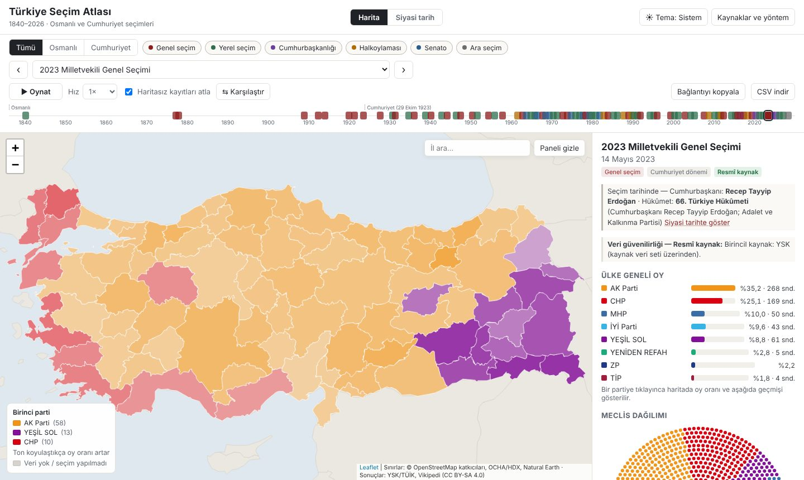
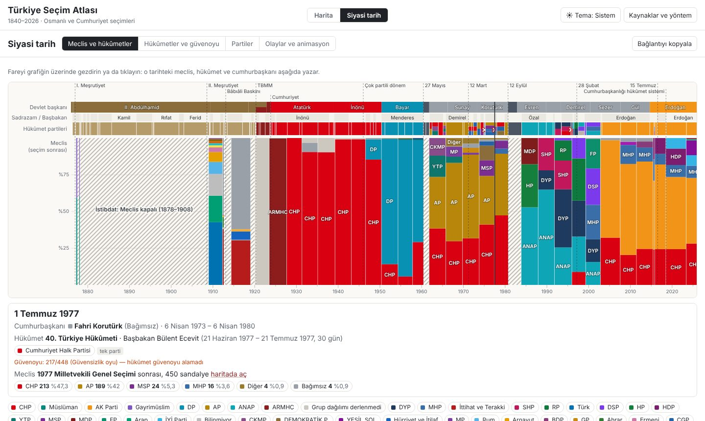
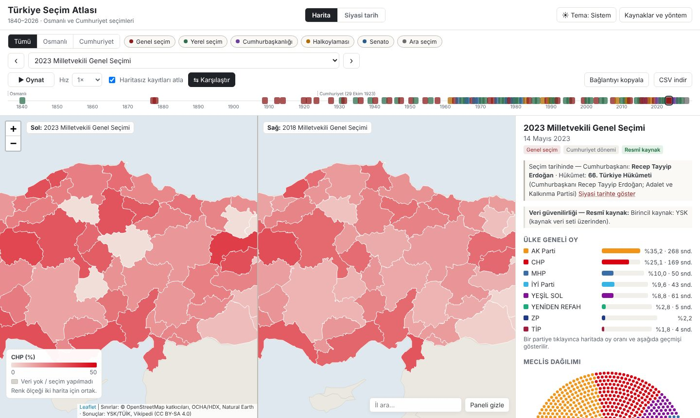
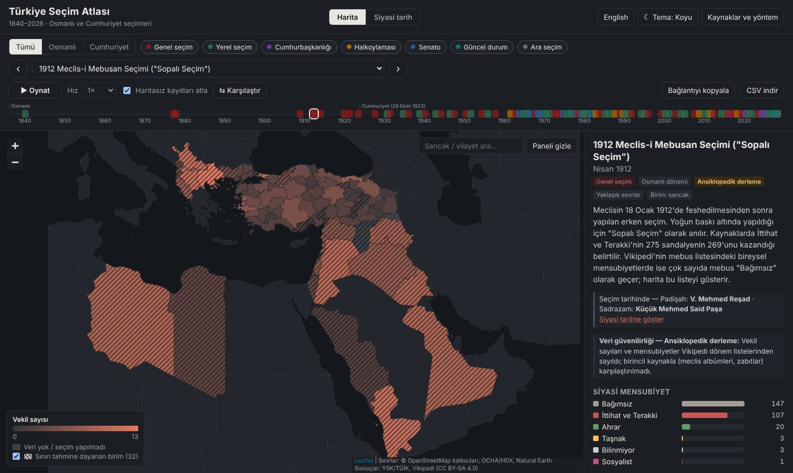
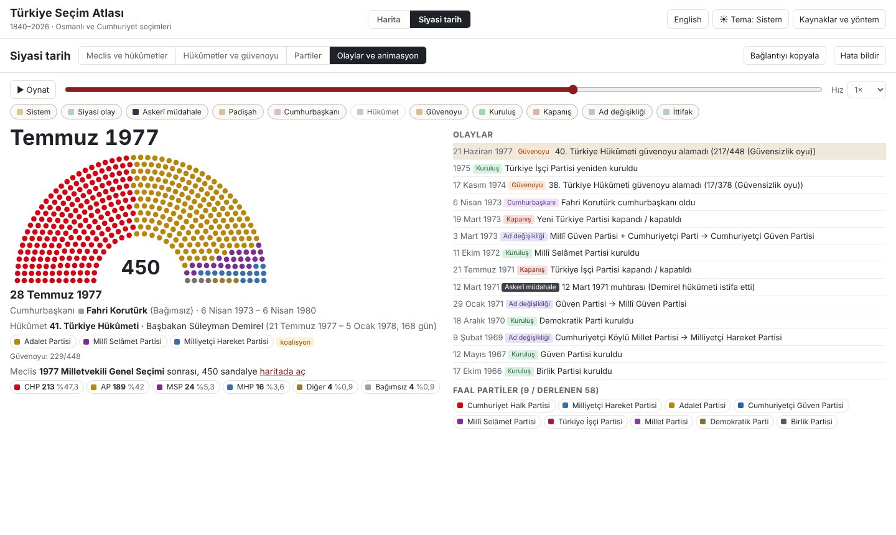
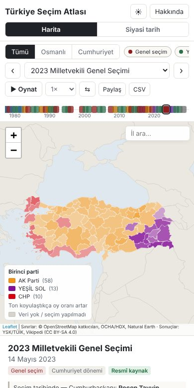

<div align="center">

# Türkiye Seçim Atlası

**1840'tan bugüne Osmanlı ve Türkiye Cumhuriyeti seçimleri, döneminin sınırlarıyla haritada.**<br>
Meclisler, hükûmetler, padişahlar, cumhurbaşkanları, partiler ve siyasi olaylarla birlikte.

[**Siteyi aç →**](https://ahmtaltug.github.io/TurkSiyasiTarihi/)

[](https://github.com/ahmtaltug/TurkSiyasiTarihi/actions/workflows/pages.yml)




</div>

## Neler var

| | |
|---|---|
| **88 seçim kaydı** | 1840 Muhassıllık meclisleri, 1877–1919 Meclis-i Mebusan, 1920–1946 TBMM seçimleri, 1950–2023 genel ve yerel seçimler, Senato seçimleri, halkoylamaları, cumhurbaşkanlığı seçimleri ve 2026 ara seçimi. |
| **Döneminin sınırları** | Osmanlı'da vilayet ve sancaklar, Cumhuriyet'te o yılın illeri ve adları (ör. Seyhan, Çoruh, Urfa, İçel). Tahmine dayanan sınırlar haritada taralıdır. |
| **Siyasi tarih** | 1876'dan bugüne meclis sandalye dağılımı, padişahlar, sadrazamlar, cumhurbaşkanları, başbakanlar, 73 hükûmet ve koalisyonları, güvenoyları, 60 parti ve ittifakın soy ağacı, 228 olay. |
| **Analiz** | İki seçimi yan yana karşılaştırma, aynı türdeki önceki seçime göre il il değişim, il ve parti geçmişi, demografik göstergelerle korelasyon. |
| **Kaynak şeffaflığı** | Her kayıtta güvenilirlik rozeti ve kaynak bağlantısı; neyin nasıl doğrulandığı [doğrulama raporunda](docs/DOGRULAMA.md). |

<table>
<tr>
<td width="50%"><br><sub><b>Siyasi tarih:</b> Meclis dağılımı, hükûmetler ve devlet başkanları tek grafikte.</sub></td>
<td width="50%"><br><sub><b>Karşılaştırma:</b> İki seçim eşzamanlı haritalarda; il il farklar panelde.</sub></td>
</tr>
<tr>
<td><br><sub><b>Osmanlı dönemi:</b> 1912 seçimi, sancak başına mebus sayısı (koyu tema).</sub></td>
<td><br><sub><b>Olaylar ve animasyon:</b> Seçilen tarihteki meclis, hükûmet ve olaylar.</sub></td>
</tr>
</table>

## Özellikler

**Harita**
- Görünümler: birinci parti ya da aday, partinin oy oranı, katılım, vekil sayısı, grup payı ve önceki seçime göre değişim.
- Zaman atlamalı oynatma (0,5×–4×); iki seçim arasındaki siyasi olaylar haritanın üzerinde gösterilir.
- İl kartı: oylar, sandalyeler, 1950 öncesi için vekil adları, ilin nüfus göstergeleri ve aynı türdeki bütün seçimlerdeki geçmişi.
- Parti kartı: ülke geneli oy geçmişi ile kuruluş, kapanış, ad değişiklikleri, öncül ve ardıl partiler, ittifaklar.
- Karşılaştırma modu, demografik saçılım grafiği, sıralanabilir il tablosu, il arama, CSV indirme.

**Siyasi tarih**
- *Meclis ve hükûmetler:* 1876'dan bugüne tek grafik. Meclisin kapalı olduğu dönemler (İstibdat, 1960 ve 1980 askerî yönetimleri) taralıdır.
- *Hükûmetler ve güvenoyu:* Cumhuriyet hükûmetleri ve Osmanlı sadrazamları tablosu.
- *Partiler:* Faaliyet dönemleri ve ad değişiklikleriyle zaman çizelgesi; tıklayınca soy ağacı açılır.
- *Olaylar ve animasyon:* 1876'dan bugüne oynatılabilir zaman.

**Kullanım kolaylığı**
- Her görünüm paylaşılabilir bağlantıyla açılır (ör. `#e=1946&u=istanbul`, `#v=tarih&t=chart&d=1960-05-27`).
- Açık ve koyu tema (tarayıcı tercihine göre), mobil uyumlu arayüz, klavye kısayolları (← → boşluk / Esc).
- Çevrimdışı çalışır ve telefona uygulama olarak eklenebilir (PWA).

<p align="center"></p>

## Kapsam

| Dönem | Seçimler | Haritada gösterilen |
|---|---|---|
| 1840 | Muhassıllık meclisleri | Açıklama (derlenmiş sonuç yok) |
| 1877–1919 | Meclis-i Mebusan: 1877 (I ve II), 1908, 1912, 1914, 1919 | Vilayet ya da sancak başına mebus sayısı; kaynakta varsa mensubiyet |
| 1920–1946 | TBMM I.–VIII. dönem seçimleri | İl başına milletvekili ve parti; 1946 için yaklaşık il oyları |
| 1930–1946 | Belediye seçimleri | 1930'da SCF'nin kazandığı belediyeler; diğer yıllarda dönemin sınırları |
| 1950–2024 | 20 genel, 15 yerel, 8 Senato, 7 halkoylaması, 4 cumhurbaşkanlığı seçimi | İl düzeyinde oy, oran, sandalye, katılım |
| 2026 | 7 Haziran 2026 ara seçimi | Seçim yapılan birimlerin il toplamı |


## Veri ve güvenilirlik

| Veri | Kaynak |
|---|---|
| 1950–2026 sonuçları, 1950–1999 il sınırları | [Türkiye Seçim Haritası açık veri seti](https://github.com/hamiKumbasae/turkiye-secim-haritasi) (CC BY-SA 4.0; YSK, TÜİK/DİE ve Vikipedi'ye dayanır) |
| 1877–1946 vekil listeleri, hükûmetler, sadrazamlar, cumhurbaşkanları, parti soy ağacı | Türkçe Vikipedi (CC BY-SA 4.0) |
| İl nüfusu, alan, kişi başı GSYH, yaşam beklentisi | Türkçe ve İngilizce Vikipedi tabloları (TÜİK verisine dayanır) |
| Arka plan haritası, Osmanlı vilayetlerinin dayandığı bölgeler | [Natural Earth](https://www.naturalearthdata.com/) (kamu malı) |

Her seçim kaydında bir **güvenilirlik rozeti** bulunur: resmî kaynak, ansiklopedik derleme, kısmi/yaklaşık ya da sonuç verisi yok.
Başlıca sınırlamalar:

- 1950 öncesi sınırlar yaklaşıktır. 1950 öncesinde il düzeyinde oy yoktur; vekil sayıları ve mensubiyetler gösterilir.
- 1908–1914 mensubiyetleri Vikipedi listelerinin sınıflandırmasıdır ve literatürdeki toplu rakamlarla uyuşmayabilir.
- Siyasi tarih verisi birincil kaynaklarla (TBMM tutanakları, Resmî Gazete) karşılaştırılmadı. Meclis grafiği seçim sonrası durumu gösterir.
- Demografik göstergeler günümüz il sınırlarına göredir. İl düzeyinde kentleşme ve göç verisi yoktur; korelasyon nedensellik göstermez.

Ayrıntılar: [docs/DOGRULAMA.md](docs/DOGRULAMA.md) · Sürüm geçmişi: [CHANGELOG.md](CHANGELOG.md) · Olası gelecek çalışmalar: [ROADMAP.md](ROADMAP.md)

## Atıf

Bu projeyi kullanırsanız [CITATION.cff](CITATION.cff) dosyasındaki bilgilerle atıf yapabilirsiniz; GitHub'daki **Cite this repository** düğmesi de aynı bilgiyi verir.
Veriyi kullanırken asıl kaynaklarına da atıf yapın.

## Kendi kopyanızı yayınlamak (GitHub Pages)

1. GitHub'da **Settings → Pages → Build and deployment → Source: GitHub Actions** seçin.
2. `main` dalına her push'ta `.github/workflows/pages.yml` veriyi denetler ve siteyi yayınlar.
   Adres: `https://<kullanıcı-adı>.github.io/<depo-adı>/`

Alternatif yöntem: depo kökündeki `index.html`, `css/`, `js/`, `vendor/` ve `data/` klasörlerini Netlify Drop ya da Cloudflare Pages'e
yükleyin. Derleme adımı gerekmez.

Yerelde denemek için:

```bash
python3 -m http.server 8000   # http://localhost:8000
```

## Veriyi yeniden üretmek

Yayındaki veri (`data/`) depoda hazır gelir. Baştan üretmek için Python 3, `pip install shapely` ve `npm i -g mapshaper` gerekir:

```bash
scripts/build_all.sh          # kaynakları indirir, data/ klasörünü yeniden yazar, denetler
scripts/build_all.sh --wiki   # Vikipedi metinlerini de yeniden indirir (sonuçlar değişebilir)
```

| Betik | Görevi |
|---|---|
| `scripts/fetch_sources.sh` | Kaynak veri setinin sabit sürümünü (yalnız gerekli klasörler) ve Natural Earth'ü indirir. |
| `scripts/build_modern.py` | 1950–2026 il sonuçlarını ve 1950–1999 il sınırlarını uygulamanın biçimine çevirir. |
| `scripts/build_historical.py` | 1877–1946 vekil listelerini ayrıştırır ve dönemin sınırlarını kurar. Sınırlar, günümüz ilçelerinin o yıldaki bağlılığına ve Natural Earth bölgelerinin birleştirilmesine dayanır. |
| `scripts/build_geo.sh` | Sınırları birleştirir, sadeleştirir ve TopoJSON'a çevirir. |
| `scripts/build_index.py` | Seçim listesini ve parti renklerini üretir. |
| `scripts/build_history.py` | Hükûmetleri, cumhurbaşkanlarını, meclis dağılımlarını, parti soy ağacını, olayları ve il demografisini Vikipedi metinlerinden `data/history.json` ve `data/demographics.json` dosyalarına derler. |
| `scripts/verify_wiki.py` | Parti ve aday adlarını seçimlerin Vikipedi maddeleriyle karşılaştırır (`scripts/fetch_sources.sh --verify` sonrası). |
| `scripts/validate.py` | Seçim dosyalarının ve sınırların tutarlılığını denetler; CI'da da çalışır. |
| `tests/smoke.js` | Tarayıcı testi: bütün seçimleri ve görünümleri açar; CI'da her PR'da çalışır. |

### Proje yapısı

| Yol | İçerik |
|---|---|
| `index.html`, `css/`, `js/app.js` | Harita bölümü |
| `js/history.js` | Siyasi tarih bölümü (meclis–hükûmet grafiği, hükûmetler, partiler, olay animasyonu) |
| `data/elections/`, `data/geo/` | Seçim sonuçları ve dönem sınırları (TopoJSON) |
| `data/history.json`, `data/demographics.json` | Siyasi tarih ve il demografisi |
| `sources/wikipedia/` | Derlemede kullanılan Vikipedi metinlerinin sabit kopyaları |
| `sw.js`, `manifest.webmanifest` | Çevrimdışı önbellek ve uygulama bildirimi |

### Veri biçimi

`data/index.json` seçimlerin listesidir. `data/elections/<id>.json` dosyalarında şu alanlar bulunur:
`units` (birim kimliği → `name`, `winner`, `votes`, `pct`, `seats`, `turnout`, `members`…), `national`, `notes` ve `sources`.
`data/geo/<geo>.json` TopoJSON biçimindedir ve özellik kimlikleri `units` anahtarlarıyla eşleşir.
Yeni bir seçim eklemek için aynı biçimde bir dosya yazmak ve `scripts/build_index.py`'yi çalıştırmak yeterlidir.

## Yöntem ve sınırlamalar (ayrıntılı)

- **1950 öncesi sınırlar yaklaşıktır.** Türkiye içindeki birimler, günümüz ilçelerinin o yıldaki il ya da sancak bağlılığına göre
  birleştirildi. Bu, kaldırılan illeri (Gelibolu, Ergani, Genç, Siverek, Kozan, Cebelibereket, Şebinkarahisar, Aksaray, Oltu,
  Ardahan), 1933–1936 arasındaki Çoruh ilini ve Hatay'ın 1939'da katılmasını kapsar. Bazı ilçelerin tarihî bağlılığı tahmine
  dayanır; ayrıntılar `scripts/build_historical.py` içindeki `tr_unit` işlevindedir. Türkiye dışındaki vilayetler günümüz idari
  bölgelerinden kurulduğu için kenar hatları tarihî sınırlarla örtüşmez.
- **1950 öncesinde il düzeyinde oy sayısı yoktur.** Seçimler iki dereceliydi. Gösterilen değerler Vikipedi listelerinden sayılan vekil
  sayılarıdır. Listeler dönem boyunca görev yapan herkesi içerir. Açıklamasında "yerine" ya da "ara seçim" geçenler ayrıldı, ama
  bütün ara seçimler bu şekilde işaretli değildir. Bu yüzden toplamlar resmî sandalye sayısından fazla olabilir.
- **1912 ve 1914 listelerindeki parti mensubiyetleri** literatürdeki toplu rakamlarla uyuşmaz; örneğin 1912 için genellikle
  "İttihat ve Terakki 269/275" denir. Osmanlı seçimlerinde harita bu nedenle varsayılan olarak vekil sayısını gösterir.
- **1946 il oyları** Vikipedi'nin seçim mazbatalarından derlediği tablodan alındı. Bazı değerler yaklaşıktır, bazıları bilinmemektedir.
- **1950 sonrası** kaynak veri setinin değerleri kullanıldı. Kaynaktaki yalnız bir değer düzeltildi: 1968 Van il genel meclisi CGP oyu,
  geçerli oy toplamıyla birebir tutan değere çevrildi. Parti toplamı geçerli oyu aşan birkaç kayıt değiştirilmeden işaretlendi.
- **Siyasi tarih verisi** (hükûmetler, güvenoyları, partiler) Vikipedi liste ve bilgi kutularından derlenmiştir; birincil kaynakla karşılaştırılmadı. Meclis grafiği seçim sonrası durumu gösterir; dönem içi değişiklikler yoktur.
- **Demografi:** Nüfuslar günümüz il sınırlarına göredir ve eski seçimlerde o dönemin illerine toplanır; ayrılan ilçeler ayrı izlenemediği için yaklaşıktır. İl bazında kentleşme ve göç verisi yoktur. Korelasyon nedensellik göstermez.
- Ülke toplamları il verilerinin toplanmasıyla hesaplandığından resmî ilan edilen oranlardan birkaç onda bir puan farklı olabilir.

## Lisans

Kod MIT lisanslıdır. Veri, kaynaklarının lisansı gereği CC BY-SA 4.0'dır; sınır geometrileri ODbL ve CC BY-IGO kaynaklıdır.
Ayrıntılar [LICENSE-DATA.md](LICENSE-DATA.md) dosyasındadır.
